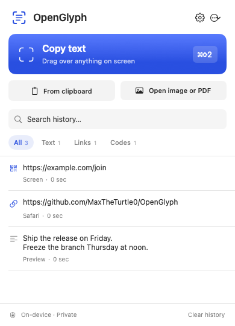

# OpenGlyph

A free, open-source macOS menu bar app that copies text from your screen. Press **⌘⇧2**, drag over text or a QR code, then paste. Apple Vision recognizes everything on your Mac, with no account or network requests.

Inspired by the workflow of [Letra](https://getletra.app/). OpenGlyph is an independent implementation with its own code and artwork, licensed under MIT.



## What works

- Global capture shortcut with a frozen selection overlay, Retina resolution, multi-display support, and Escape/right-click cancellation.
- Offline text recognition, QR codes, and barcodes.
- Clipboard image and file import. PNG, JPEG, TIFF, HEIC, and multi-page PDF import.
- Local searchable history with text, link, and code filters. Click to copy; right-click to view full text, open a web link, or delete.
- Accurate/fast recognition, automatic or explicit language selection, configurable line breaks, and optional QR web-link opening.
- Custom shortcuts, launch at login, permission onboarding, and URL commands for Raycast, Alfred, or Shortcuts.

Language availability comes from Apple Vision on your macOS version. Clear handwriting can work; recognition accuracy depends on the source image. Fast mode supports fewer languages.

## Install on a Mac

macOS 14 or later, Apple Silicon or Intel. Download a release archive, unzip it, and move OpenGlyph.app into Applications. Local builds are ad-hoc signed; public builds are not Apple-notarized. See [building and signing](docs/BUILDING.md) for details.

On first launch, follow onboarding. For screen capture, grant OpenGlyph permission in **System Settings → Privacy & Security → Screen & System Audio Recording**. macOS may require quitting and reopening the app after granting permission. File and clipboard imports work without screen access.

OpenGlyph lives in the menu bar. Its icon looks like text inside a viewfinder. Reopening the app brings its menu forward.

## Build and run

Requires Xcode command line tools and Swift 5.9 or later. No third-party dependencies.

```sh
swift test
./scripts/build-app.sh
./scripts/install.sh --skip-build
```

The installer places the app in `~/Applications/OpenGlyph.app` and opens it. A universal build supports both Apple Silicon and Intel Macs:

```sh
./scripts/build-app.sh --universal
./scripts/package.sh --skip-build --dmg
```

## Automation

```sh
open 'openglyph://capture'
open 'openglyph://clipboard'
open 'openglyph://history'
open 'openglyph://settings'
open 'openglyph://onboarding'
```

Use the bundled executable for command-line recognition:

```sh
~/Applications/OpenGlyph.app/Contents/MacOS/OpenGlyph --ocr image.png --json
~/Applications/OpenGlyph.app/Contents/MacOS/OpenGlyph --ocr document.pdf --language de-DE --no-line-breaks
~/Applications/OpenGlyph.app/Contents/MacOS/OpenGlyph --ocr image.png --copy
~/Applications/OpenGlyph.app/Contents/MacOS/OpenGlyph --diagnostics
```

CLI OCR prints text by default. `--fast`, `--language CODE`, `--no-line-breaks`, `--json`, and `--copy` are optional. CLI recognition does not add history.

## Privacy and limits

Screen snapshots stay in memory only for selection and recognition. OpenGlyph saves recognized text in `~/Library/Application Support/OpenGlyph/history.json` when history is enabled. The directory and file have private permissions. History is bounded to 500 captures and 32 MB. You can turn it off or clear it from the menu.

File imports are limited to 100 MB, 40 million image pixels, 100 PDF pages, and one million result characters. Encrypted PDFs must be unlocked first. Only HTTP and HTTPS links can open; QR web-link opening is off by default.

## Development and verification

`swift test` covers actual Vision text recognition, QR/barcodes, image formats and rotation, PDF pages and limits, history/settings persistence, and capture coordinates. Render the native SwiftUI screens for visual review:

```sh
swift build
.build/debug/OpenGlyph --render-previews /tmp/openglyph-previews
swift tools/GenerateFixtures.swift /tmp/openglyph-fixtures
.build/debug/OpenGlyph --ocr /tmp/openglyph-fixtures/text.png --json
```

See [verification notes](docs/VERIFICATION.md) for checks run on the initial build and remaining manual checks.

## Other platforms

macOS is the supported platform. Apple Vision, AppKit, and ScreenCaptureKit are macOS APIs. Windows and Linux need separate capture, OCR, shortcut, and UI implementations. Those ports are not part of this initial build.

## Contributing

Small fixes and focused improvements are welcome. Include the behavior that changes and the checks you ran. Keep recognition local, avoid accounts and analytics, and preserve the simple select-copy-paste workflow. MIT licensed; see [LICENSE](LICENSE).
